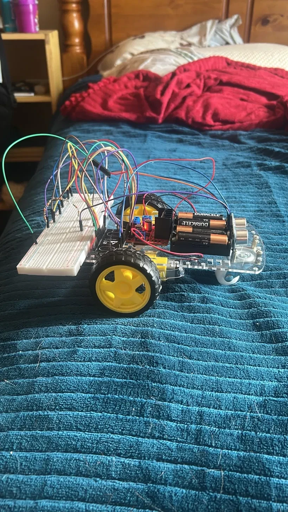

# Carrinho CitizenTech — patrulha preventiva contra enchentes com DHT22 + IA

**Global Solution 2026.2 · Project-Based Maker Lab · FIAP — Engenharia de Software, 4º ano**

Evolução do robô autônomo do CP2 (ESP32 + HC-SR04 + TinyML) para o tema
**CitizenTech — Monitoramento ambiental no campo e na cidade**, aplicado à
**prevenção de enchentes urbanas**. O carrinho patrulha ruas, calçadas e
galerias sozinho, detecta **pontos obstruídos** (lixo e entulho no caminho,
como na frente de bueiros) e agora carrega um **sensor DHT22** que acompanha
a temperatura e a umidade do ar. Os dados vão por Wi-Fi para um computador,
onde são classificados e transformados em **relatórios em linguagem natural
(LLM)** para a defesa civil, a equipe de limpeza urbana e os moradores.

## Integrantes

| Nome | RM |
| --- | --- |
| João Pedro de Albuquerque Oliveira | 551579 |
| Pedro Augusto Carneiro Barone Bomfim | 99781 |
| Matheus Augusto Santos Rego | 551466 |


## Vídeo demonstrativo

▶️ **[Assista no YouTube](https://youtube.com/COLOQUE-O-LINK-AQUI)** (até 6 minutos)

## O problema

Boa parte dos alagamentos urbanos é agravada por **bueiros e galerias
entupidos** com lixo e entulho. A vistoria é manual, rara e, em galerias,
perigosa para as pessoas — e quando a chuva forte chega já é tarde para
limpar. Um sensor fixo vê só um ponto.

O carrinho percorre o trajeto sozinho e:

- **registra cada obstáculo** encontrado a até 20 cm (ponto obstruído que
  precisa de limpeza), sem precisar de ninguém dentro da galeria;
- **acompanha a umidade e a temperatura do ar** em vários pontos — ar quente
  e saturado de umidade é um dos sinais de que pode vir chuva forte;
- entrega um **relatório simples** dizendo quantas obstruções encontrou, como
  estava o ar e o que priorizar **antes** da chuva.

> O DHT22 **não mede chuva nem nível de água**: ele fornece um indício
> (umidade alta), não uma previsão de enchente. Veja
> [Limitações e próximos passos](#limitações-e-próximos-passos).

## Como funciona

```text
┌─────────────────────────── ESP32 (carrinho) ───────────────────────────┐
│                                                                         │
│  HC-SR04 ──► janela 10 leituras ──► TinyML (Edge Impulse) ──► motores   │
│   (10 Hz)                          livre/aproximando/bloqueado  L298N   │
│                                                                         │
│  DHT22 ──► tarefa própria (core 0, a cada 2,5 s) ──┐                    │
│                                                    ▼                    │
│                              servidor HTTP  GET /state (JSON)           │
└────────────────────────────────────┬────────────────────────────────────┘
                                     │ Wi-Fi
┌────────────────────────────────────▼──── computador ────────────────────┐
│  monitor_ia.py                                                          │
│   ├─ grava CSV (dados/)                                                 │
│   ├─ classifica o ar por regras: confortável / quente / abafado / seco  │
│   ├─ conta leituras com obstáculo a até 20 cm (pontos obstruídos)       │
│   └─ a cada N s: resume a janela e gera relatório (relatorios/)         │
│        ├─ LLM (Claude) — texto para gestores e moradores                │
│        └─ local (sem internet/custo) — fallback automático              │
└─────────────────────────────────────────────────────────────────────────┘
```

### Camadas de IA

1. **TinyML embarcado (herdado do CP2):** rede neural do Edge Impulse rodando
   no ESP32 classifica a janela de distâncias em `livre`, `aproximando` ou
   `bloqueado` (88,89% no teste real). Junto com limites de distância, decide
   avançar, reduzir (40–20 cm) ou parar/dar ré/girar (≤ 20 cm) — **sem comando
   manual**. Cada leitura a até 20 cm entra no relatório como **obstrução
   encontrada** na patrulha.
2. **Classificação do ar:** regras sobre temperatura e umidade
   (linha de base até existir dado real suficiente para treinar um modelo).
   Para o tema de enchentes, a classe de interesse é **`abafado`** — ar quente
   **e** saturado de umidade, condição comum antes de temporais de verão:

   | Classe | Regra |
   | --- | --- |
   | `quente` | T ≥ 32 °C (ajustável com `--limite-calor`) |
   | `abafado` | T ≥ 28 °C **e** U ≥ 70% |
   | `seco` | U < 30% |
   | `confortavel` | demais casos |
   | `sem_leitura` | DHT22 sem leitura válida |

3. **LLM:** o resumo numérico da janela (médias, mín/máx, variação, contagem
   de classes, leituras com obstáculo, leituras inválidas) vai para o Claude
   com instruções para
   **não inventar dados**, avisar quando o sensor falhou e terminar com uma
   recomendação prática. Sem chave de API, o relatório é gerado localmente.

### Robustez

- O DHT22 roda em **tarefa FreeRTOS separada**: a leitura bloqueante (~5 ms)
  não atrasa o laço de 100 ms do ultrassom, que descarta a janela e para os
  motores se atrasar mais de 20 ms.
- O Wi-Fi também tem tarefa própria: cliente HTTP lento não trava a navegação.
- Leitura inválida do DHT22 vira `null` no JSON e `sem_leitura` no CSV; os
  motores **continuam** funcionando sem o DHT22.
- Leitura inválida do ultrassom, erro de inferência ou confiança inválida
  param os motores (mantido do CP2).
- O monitor tolera o carrinho fora do ar e avisa como resolver.

## Componentes e ligação

ESP32 DevKit, HC-SR04, **DHT22**, ponte H L298N, 2 motores TT, 4 pilhas AA,
powerbank, resistores (5 × 330 Ω, 1 × 10 kΩ). Mapa de pinos, esquema e fotos em
**[docs/ligacao.md](docs/ligacao.md)**.

| Sinal | GPIO |
| --- | --- |
| DHT22 DATA | 4 |
| HC-SR04 TRIG / ECHO | 23 / 22 (ECHO com divisor) |
| L298N ENA, IN1, IN2 | 25, 26, 27 |
| L298N ENB, IN3, IN4 | 33, 32, 21 |



## Instalação e execução

### 1. Firmware (Arduino IDE 2)

1. Instale o core **esp32** (Espressif) no Boards Manager.
2. No Library Manager, instale **DHT sensor library** (Adafruit) e
   **Adafruit Unified Sensor**.
3. *Sketch → Include Library → Add .ZIP Library…* e escolha
   [`firmware/modelo/edge-impulse-arduino-real-v1-float32.zip`](firmware/modelo/)
   (modelo TinyML do CP2).
4. Copie `firmware/carrinho/wifi_config.example.h` para
   `firmware/carrinho/wifi_config.h` e preencha SSID e senha da rede
   **2,4 GHz** (o arquivo está no `.gitignore` — a senha não vai para o GitHub).
   Sem esse arquivo o carrinho funciona, só que sem Wi-Fi.
5. Abra `firmware/carrinho/carrinho.ino`, selecione **ESP32 Dev Module** e a
   porta COM, e grave.
6. Monitor serial a 115200 baud: anote o IP em `# wifi,connected,http://<IP>`.
   O carrinho **arma sozinho após 5 s**; `S` para e desarma, `A` rearma.

> Para testar só o DHT22 antes, grave
> [`firmware/teste_dht/teste_dht.ino`](firmware/teste_dht/teste_dht.ino).

### 2. Monitor com IA (computador na mesma rede)

```bash
cd python
pip install -r requirements.txt     # opcional: só para o relatório via LLM
python monitor_ia.py --host 192.168.0.50 --sem-llm
```

Com LLM (uso pago da API Anthropic):

```bash
export ANTHROPIC_API_KEY=...        # PowerShell: $env:ANTHROPIC_API_KEY="..."
python monitor_ia.py --host 192.168.0.50
```

| Opção | Padrão | Descrição |
| --- | --- | --- |
| `--host` | — | IP do ESP32 (obrigatório) |
| `--intervalo` | 3 | segundos entre leituras |
| `--relatorio-a-cada` | 120 | segundos entre relatórios |
| `--limite-calor` | 32 | °C para classificar `quente` e emitir alerta |
| `--csv` | `leituras.csv` | arquivo de saída |
| `--pasta-relatorios` | `relatorios` | onde salvar os `.md` |
| `--sem-llm` | — | relatório local, sem internet e sem custo |
| `--modelo` | `claude-sonnet-5-5` | modelo do Claude (ou variável `CLAUDE_MODEL`) |

`Ctrl+C` encerra e gera o relatório final da janela atual.

### 3. Testar sem o carrinho (simulador)

```bash
cd python
python simulador_carrinho.py --porta 8765
# em outro terminal:
python monitor_ia.py --host 127.0.0.1:8765 --sem-llm --intervalo 1 --relatorio-a-cada 60
```

O simulador responde o mesmo JSON do firmware com **dados sintéticos**
(aquecimento gradual, ~5% de falhas do DHT22, obstáculos periódicos).

## Endpoint `/state`

```json
{
  "timestamp_ms": 123456, "distance_cm": 57.214, "sensor_valid": true,
  "armed": true, "class": "livre", "confidence": 0.92969, "action": 2,
  "temperature_c": 29.4, "humidity_pct": 63.1, "dht_valid": true
}
```

`action`: 0 parar · 1 reduzir · 2 avançar · 3 ré · 4 giro à direita.
Somente leitura: os motores não são armados pela rede.

## Estrutura do repositório

```text
gs-pbml/
├── firmware/
│   ├── carrinho/          # firmware completo (abrir carrinho.ino)
│   │   ├── carrinho.ino       # laço principal: ultrassom, TinyML, motores, DHT
│   │   ├── dht_sensor.h       # DHT22 em tarefa FreeRTOS própria  (novo)
│   │   ├── network_status.h   # Wi-Fi + GET /state com temperatura/umidade
│   │   ├── wifi_config.example.h  # modelo sem senha real
│   │   ├── config.h · policy.h · navigation.h · motors.h
│   │   └── ultrasonic.h · inference.h · model_config.real.h
│   ├── teste_dht/         # sketch de bancada só do DHT22  (novo)
│   └── modelo/            # biblioteca Arduino exportada do Edge Impulse (CP2)
├── python/
│   ├── monitor_ia.py          # coleta, classificação, alerta e relatório LLM
│   ├── simulador_carrinho.py  # /state falso para testar sem hardware
│   └── requirements.txt
├── docs/
│   ├── ligacao.md         # esquema de ligação + fotos
│   ├── testes.md          # tabela de testes
│   └── imagens/
├── dados/leituras_exemplo.csv       # saída do monitor (simulador)
└── relatorios/exemplo_relatorio.md  # relatório gerado (simulador)
```

> O Arduino IDE exige que o `.ino` fique numa pasta com o mesmo nome, por isso
> o firmware está em `firmware/carrinho/` e não direto em `firmware/`.

## O que mudou em relação ao CP2

| Item | CP2 | GS (este repositório) |
| --- | --- | --- |
| Sensores | HC-SR04 | HC-SR04 + **DHT22** |
| Firmware | navegação TinyML | + tarefa do DHT22, log serial `# dht,...` |
| `/state` | distância, classe, ação | + `temperature_c`, `humidity_pct`, `dht_valid` |
| IA | TinyML embarcado | + classificação do ar + contagem de obstruções + **relatório via LLM** |
| Contexto | evitar colisões | **patrulha preventiva contra enchentes (CitizenTech)** |

O histórico completo do CP2 (coleta de dados, treino no Edge Impulse,
simulações Wokwi e evidências) está no repositório anterior,
`carrinho-tinyml`.

## Limitações e próximos passos

- **O DHT22 não detecta chuva nem enchente.** Umidade alta é só um indício;
  o próximo passo é adicionar um **sensor de chuva** e um **sensor de nível
  de água** (ex.: um segundo HC-SR04 apontado para baixo, num córrego ou
  galeria) e cruzar com a previsão do tempo.
- O alerta atual do monitor é de **calor** (`--limite-calor`). Próximo passo:
  classe e alerta próprios para **umidade crítica** (ex.: U ≥ 85%).
- O ultrassom não distingue **o que** é o obstáculo (lixo, parede, pessoa):
  toda leitura a até 20 cm conta como obstrução. Uma câmera com classificação
  de imagem resolveria isso.
- A classificação do ar é por regras; com dados reais suficientes,
  treinar um modelo (ex.: no Edge Impulse) para detectar tendência de
  aumento de umidade.
- O DHT22 tem precisão de ±0,5 °C / ±2–5% UR e resposta lenta (~2 s);
  o carrinho deve parar alguns segundos em cada ponto para leituras estáveis.
- Sem localização: o relatório não sabe **em qual bueiro** a obstrução foi
  encontrada. Próximo passo: marcar pontos (ex.: por tempo de percurso, QR
  codes nos bueiros ou GPS em área aberta).
- Alerta só no terminal; poderia ir para buzzer/LED no carrinho ou mensagem
  para a equipe de limpeza / defesa civil.
