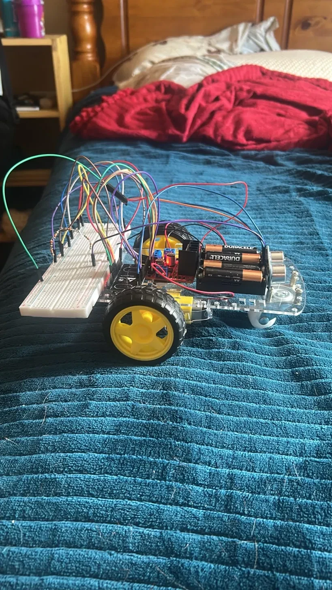
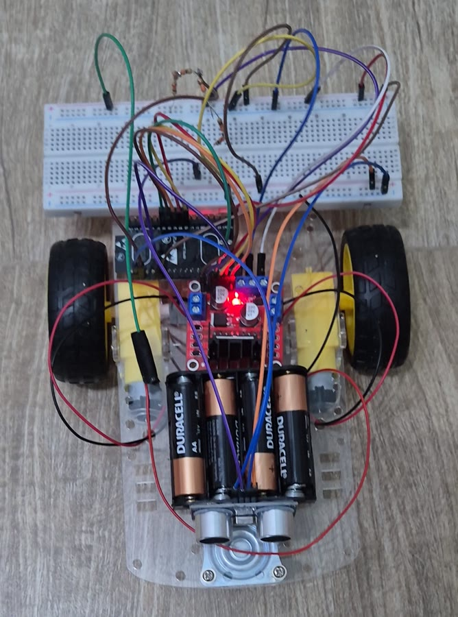
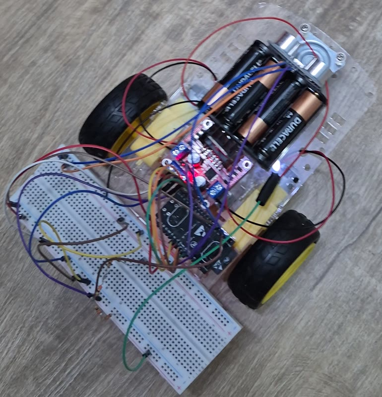
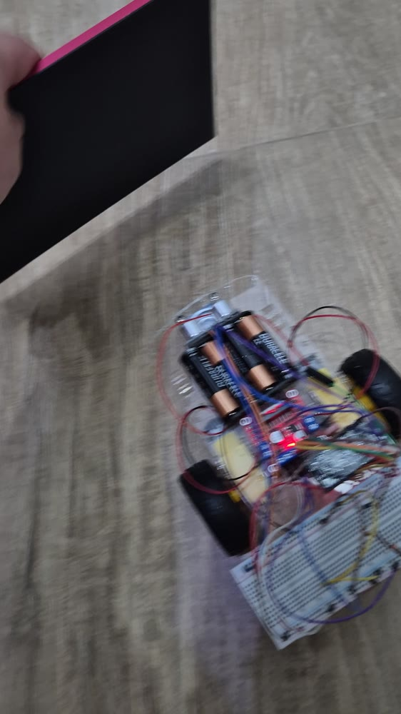
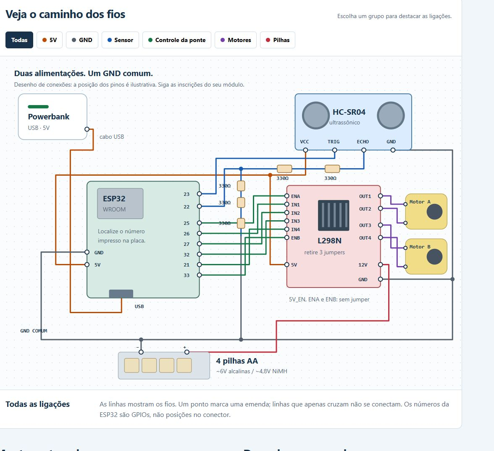

# Esquema de ligação

Os números abaixo são **GPIOs escritos na placa** (ESP32 DevKit WROOM), não a
posição do pino no conector. O mapa corresponde a
[`firmware/carrinho/config.h`](../firmware/carrinho/config.h) e
[`firmware/carrinho/dht_sensor.h`](../firmware/carrinho/dht_sensor.h).

## Componentes

| Qtd. | Componente | Função |
| --- | --- | --- |
| 1 | ESP32 DevKit (WROOM) | Processamento, TinyML, Wi-Fi |
| 1 | Sensor ultrassônico HC-SR04 | Distância até obstáculos (navegação) |
| 1 | **Sensor DHT22 (AM2302)** — sensor adicional | Temperatura e umidade do ar |
| 1 | Ponte H L298N | Acionamento dos motores |
| 2 | Motores DC TT com rodas + roda boba | Locomoção (chassi 2WD) |
| 1 | Suporte para 4 pilhas AA | Alimentação dos motores |
| 1 | Powerbank USB (ou cabo USB do PC) | Alimentação do ESP32 (5 V) |
| 5 | Resistores de 330 Ω | Divisor de tensão do ECHO do HC-SR04 |
| 1 | Resistor de 10 kΩ | Pull-up do DATA do DHT22 (só se o sensor for "solto", sem placa) |
| — | Protoboard e jumpers | Ligações |

## Mapa de pinos

| Sinal | ESP32 |
| --- | --- |
| HC-SR04 TRIG | GPIO 23 |
| HC-SR04 ECHO (após divisor) | GPIO 22 |
| **DHT22 DATA** | **GPIO 4** |
| L298N ENA (PWM motor A) | GPIO 25 |
| L298N IN1 / IN2 | GPIO 26 / GPIO 27 |
| L298N ENB (PWM motor B) | GPIO 33 |
| L298N IN3 / IN4 | GPIO 32 / GPIO 21 |

O GPIO 4 estava livre no mapa do CP2 e funciona como entrada/saída digital
mesmo com o Wi-Fi ligado (a restrição do ADC2 com Wi-Fi vale só para leitura
analógica, que o DHT22 não usa).

```text
                    ┌───────────────────────────┐
  HC-SR04 TRIG ─────┤ GPIO 23                   │
  HC-SR04 ECHO ─div─┤ GPIO 22                   │
  DHT22 DATA ───────┤ GPIO 4        ESP32       │
  L298N ENA ────────┤ GPIO 25       DevKit      │
  L298N IN1/IN2 ────┤ GPIO 26 / 27              │
  L298N ENB ────────┤ GPIO 33                   │
  L298N IN3/IN4 ────┤ GPIO 32 / 21              │
  DHT22 VCC ────────┤ 3V3                       │
  HC-SR04 VCC, L298N 5V lógica ─┤ 5V (USB)      │
  GND comum ────────┤ GND                       │
                    └───────────────────────────┘
```

## DHT22 (novo no GS)

| Pino do DHT22 | Ligação |
| --- | --- |
| VCC (+) | **3V3** da ESP32 |
| DATA (OUT) | GPIO 4 |
| GND (−) | GND comum |
| NC (só no sensor de 4 pinos) | Não ligar |

```text
3V3 ──┬──────────── DHT22 VCC
      │
    10 kΩ  (somente para o sensor solto de 4 pinos;
      │     módulos de 3 pinos já têm o resistor)
      │
GPIO 4 ┴──────────── DHT22 DATA

GND ──────────────── DHT22 GND
```

- Alimentado em **3,3 V**, o sinal DATA também fica em 3,3 V: não precisa de
  divisor (ao contrário do ECHO do HC-SR04).
- Monte o sensor **longe da ponte L298N e dos reguladores**, que esquentam e
  distorcem a leitura. De preferência na frente ou no alto do chassi, exposto ao ar.
- Com fios longos (> 1 m), use o resistor de 10 kΩ mesmo no módulo.

## HC-SR04 (mantido do CP2)

| Pino do sensor | Ligação |
| --- | --- |
| VCC | Pino 5V da ESP32 (alimentada por USB/powerbank) |
| GND | GND comum |
| TRIG | GPIO 23 |
| ECHO | GPIO 22 **através do divisor** abaixo |

```text
HC-SR04 ECHO ── 330 Ω ── 330 Ω ──┬── GPIO 22
                                 │
                        330 Ω + 330 Ω + 330 Ω (em série)
                                 │
                                GND
```

Divisor de 660 Ω / 990 Ω: 5 V × 990 / 1650 ≈ 3,0 V no GPIO. Não ligue o ECHO
direto no GPIO: a ESP32 não tolera 5 V.

## Ponte H L298N (mantida do CP2)

| Terminal | Ligação |
| --- | --- |
| ENA | GPIO 25 — **retirar o jumper ENA** |
| IN1 / IN2 | GPIO 26 / GPIO 27 |
| IN3 / IN4 | GPIO 32 / GPIO 21 |
| ENB | GPIO 33 — **retirar o jumper ENB** |
| OUT1 / OUT2 | Motor A |
| OUT3 / OUT4 | Motor B (o sentido já é compensado em `motors.h`) |
| Vs ("12V") | Positivo das 4 pilhas AA |
| GND | Negativo das pilhas e GND comum |
| 5V (lógica) | Pino 5V da ESP32 — **retirar o jumper 5V_EN** |

## Alimentação

1. ESP32 alimentada pelo powerbank (ou USB do PC durante os testes).
2. As pilhas alimentam **somente** o terminal Vs da L298N (motores).
3. O pino 5V da ESP32 alimenta VCC do HC-SR04 e a lógica 5V da L298N.
4. O pino **3V3** da ESP32 alimenta o DHT22.
5. Todos os GND unidos: ESP32, HC-SR04, DHT22, L298N e negativo das pilhas.

Nunca ligue as pilhas ao pino 5V/3V3 da ESP32 nem a um GPIO.

## Ordem de montagem do DHT22

1. Desligue USB e retire as pilhas.
2. Ligue GND do DHT22 no barramento GND comum da protoboard.
3. Ligue VCC do DHT22 no **3V3** da ESP32 (não no barramento de 5 V).
4. Ligue DATA no GPIO 4 (e o resistor de 10 kΩ entre DATA e 3V3, se necessário).
5. Grave [`firmware/teste_dht`](../firmware/teste_dht/teste_dht.ino) e confira no
   monitor serial (115200) leituras válidas a cada 2,5 s.
6. Grave o firmware completo [`firmware/carrinho`](../firmware/carrinho/carrinho.ino).
   O serial passa a mostrar `# dht,temp_c=..,umid_pct=..` a cada 5 s.

## Fotos

Carrinho do CP2, antes da instalação do DHT22:







Diagrama de ligação herdado do CP2 (sem o DHT22):



> **A fazer:** adicionar em `docs/imagens/` fotos do carrinho **com o DHT22
> instalado** (visão geral + detalhe da ligação no GPIO 4) e referenciá-las aqui.
